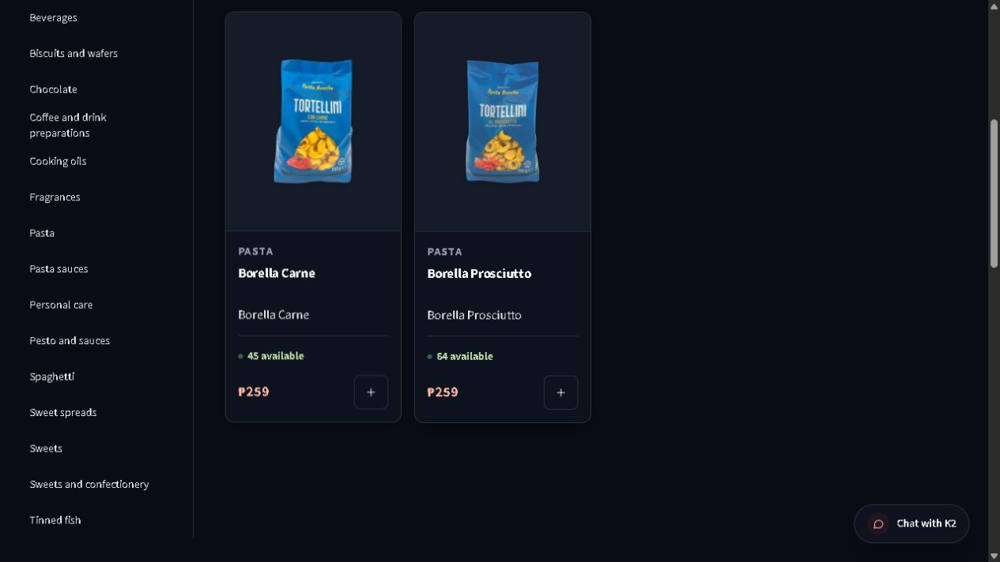

# Duplicate consolidation applied — 26 October 2026

MAP-023 / IDEA-20261025-04 and IDEA-20261026-02. This receipt supersedes the earlier prepared-only and failed-request checkpoints. The owner approved the original exact K2 schema packet and both Borella merges, then separately approved the single-function two-second lock limit. No permanent product/history deletion was performed.

## Verified production result

At 2026-10-26T06:33:40.348Z, read-only K2 `pixplcjqivlfflickobf` reconciliation confirms:

| Product | Retained SKU | Units | Original lots | Retired duplicate SKUs |
| --- | --- | ---: | ---: | --- |
| Borella Carne | 001017 | 45 | 1 | 001016, 001018 |
| Borella Prosciutto | 001020 | 64 | 2 | 001019, 001021 |

Both decisions used the deployed signed Admin controls. Carne reused its original saved request `a1e1ff16-1b02-4040-85f2-4430cfd58f96`; Prosciutto recorded `daabe964-3c96-4686-aa1f-a257fe6e2fc3`. Each has one merge receipt, two Website events and two Product Master events sharing its real parent request. Source records are Discontinued/unpublished with their original history retained.

All 196 product records, 49 original lots and 273 projected units remain. Only original lot `5de2ebb3-71ca-43b7-951a-433236650a21` moves from 001021 to 001020, changing only SKU and updated_at. Its original quantity, expiry, box, custody and every other field remain identical. Every other lot is byte-equivalent as parsed JSON. Balance changes transfer 22 on-hand/available units to 001020; no stock adjustment or lot recreation. Product/listing differences are confined to the six Borella rows and four retired Website assignments as detailed in the JSON.

The real storefront loads 116 public listings and no repeated public product names. Search `Borella` returns exactly one Carne card with45 available and one Prosciutto card with64 available. This is actual-host browser evidence, separate from local tests; projected units are not a physical count.

The wider audit disposition is complete: nine fragrance duplicate Website assignments remain paused ([receipt](FRAGRANCE_DUPLICATE_LISTINGS_20261026.md)); Torino001090 remains paused with001085 retained ([receipt](TORINO_DUPLICATE_LISTING_20261026.md)); owner-approved Pagani001151/001152 are retired and001150 remainsDraft ([receipt](PAGANI_DUPLICATE_RETIREMENT_20261026.md)). Both Galatine125g/150g records and their one unit each are retained by explicit owner decision. The196-record audit found no repeated nonempty barcode; shared photos alone do not authorize merging different package sizes.

## Schema installation and deadline repair

The original approved source SHA `d9f3ab51dbc62a76cdc14ebc168c32b4a6a8b8a1c228c55d539d31b25120cc8b` was installed once with six-function/ledger/ACL/RLS/business/audit conservation postflight. Per-SKU Website event uniqueness retains all real parent-request lineage. The installer must not be replayed.

After genuine signed Carne attempts refused `K2_CATEGORY_POLICY_DEADLINES_REQUIRED`, the owner separately approved only `lock_timeout='2s'` on `k2_private.execute_product_sku_merge_v1(jsonb,uuid)`. Packet SHA `62d7affae2896b779e71e368eca76836c35da5669b3de6d1994acf928149a329` applied once. At06:28:23.481Z postflight verifies unchanged function logic/owner/ACL and all captured business/audit hashes, with exact config `search_path=""`, `lock_timeout=2s`. The inherited statement deadline and guard refusing zero/>10seconds remain. Current maintained migration source includes this config; the historical original installed source receipt deliberately retains its original SHA.

Fresh K2 identity and readiness passed before the production steps:8verified/2owner/3connector/0failed. Encrypted post-install backup `current-pixplcjqivlfflickobf-2026-10-26T060903948Z-b69d1e297447` restores75public relations/latest20261025; owned database stopped. Managed Vault/Storage/provider recovery is outside this proof.

## Verification and source publication

Final30focused SQL checks cover the production-shaped audit constraint, signed decisions, original-lot conservation, refusal/retry and callerlock0/statement8s. Invalid statement0/11s refusal and restoration pass.16readiness tests and final `npm run verify:development` pass. Local release coverage reconciles the retained1115base passes/3navigation failures with12unchanged focused comparison passes,47storefront passes plus unchanged focused logo pass, full6-case auth successor and every remaining manifest suite/packaging/both production builds. The aggregate itself did not exit0; original failures are preserved. This documentation update requires no new application build.

Private evidence: `.tools/duplicate-products-20261026/borella-final-readback.json`, `borella-final-conservation.json`, `carne-merged-readback.json`, `lock-deadline-postflight.json`, `installation-postflight.json`, backup restore receipt, release logs/results and `deadline-development.log`. Durable sanitized conservation/event evidence is paired in this JSON. Source promotion to main remains the only release action, tracked in MAP-023 until exact remote/artifact verification.

## Recovery

Preserve all source records, events, signed request keys and encrypted backups. Do not replay either installation executor, re-add the old actor/request-only constraint after multi-source events, delete audit history, or rewind the database over later activity. Any correction needs a reviewed forward change preserving the original lot IDs and subsequent operations. Unknown saves reconcile the original request before any retry. Website-only pauses can be reversed through a fresh supported assignment decision after checking current state; retirement/lot recovery requires its own reviewed forward operation. Broader physical-device, Auth, order/payment and fulfillment acceptance remains in its existing MAP items.
